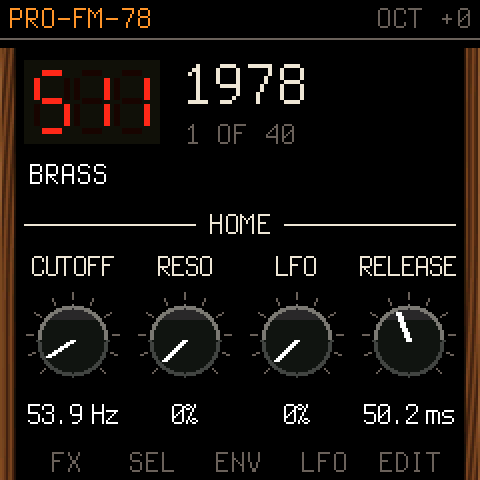
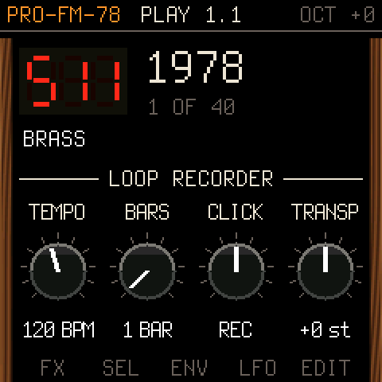

# PRO-FM-78

A vintage polysynth for the FM-1, with a chord generator, an arpeggiator and a loop recorder.

 

- **The sound:** Melodee's analogue-poly engine by Kerem Kilic, with its 200 factory programs from 1978 onwards.
  Eight voices on both cores. Each program sets POLY or UNISON, the filter type, Poly-Mod, glide and VINTAGE drift.
- **Chord generator (SEL):** each key plays a chord, inverted, voiced and strummed.
- **Arpeggiator (ARP):** UP, DOWN, UP/DN, RANDOM or as played, from 1/4 to 1/32, over 1–4 octaves. It has swing,
  latch and fixed velocity.
- **Loop recorder (SEQ, PLAY, REC):** records 1–8 bar loops in real time. Keys are quantised to 1/16, and arp
  notes are recorded as they fall. You can overdub, transpose and use a click. SAVE keeps the loop.
- **Sync:** the arp and the loop follow a DAW's MIDI clock, and its start and stop.

It runs as its own firmware, or as a module inside [fm1-dock](https://github.com/joakimeriksson/fm1-dock).

## Install

**As a firmware:** download `pro-fm-78-X.Y.fwsc` from [Releases](../../releases). Install it with fm1-dock's
installer page or `tools/fm1_install.py`. This replaces the firmware on your FM-1. Its identity is `FM-1_986`.

**As a module in fm1-dock:** build `build/profm78.dock` (see below), then run this in fm1-dock:

```sh
tools/dock.py deploy /path/to/pro-fm-78/build/profm78.dock
```

## Controls

| Control | What it does |
| --- | --- |
| Keys / MIDI | Play notes. Key force gives velocity and aftertouch. MIDI also carries bend, CC 1 (the wheel) and channel pressure |
| OCT- / OCT+ | Shift the keys' octave, shown on the top line |
| ALGORITHM | Choose a type: 1978 (the originals, 511–558), BASS, LEAD, … FX, INIT |
| PRESETS, SELECT | Choose a program of that type |
| HOME | Cutoff, resonance, LFO amount and amp release on KNOB 1–4. Hold for 1.5 s to open fm1-dock's module list |
| FX SEL ENV LFO EDIT | A page of four controls each. Press again for the section's next page: FX the mixer, SEL the chord generator, ENV the envelopes, LFO the LFO and Poly-Mod, EDIT the filter, oscillators and waveforms |
| ARP | Arpeggiator: mode, rate, octaves, gate. Press again for tempo, swing, latch, velocity |
| SEQ | Loop recorder: tempo, bars, click, transpose |
| PLAY | Start or stop the loop |
| REC | When stopped: arm (your first note starts recording). When playing: overdub on or off. Hold for 1 s to clear the loop: a red bar fills while you hold |
| SAVE | Keep the loop and the arp and loop settings in flash. It only saves once the loop is stopped and the notes have faded |
| CC 74 71 73 72 | Cutoff, resonance, amp attack, amp release |

Edits to a program last until you pick another program.

## Build

This repository holds the module (`profm78/`). The firmware around it is fm1-dock's. You need:

- [fm1-dock](https://github.com/joakimeriksson/fm1-dock) checked out next to this repository (or set `FM1_DOCK`),
  built and tested at `ca83cb6`.
- fm1-dock's JieLi toolchain (`JIELI_TOOLCHAIN`) and, for the firmware, the AC79 SDK (`AC79_SDK`). See
  fm1-dock's README. On macOS the toolchain runs in Docker.

```sh
./build.sh                      # build/profm78.dock: the module
RELEASE=0.1 ./build.sh firmware # build/pro-fm-78-0.1.fwsc: the firmware
tests/run_host.sh               # every check on this computer, plus build/host/profm78.wav and screenshots
```

`build.sh` applies `patches/fm1-dock-uc25-flash.patch` to fm1-dock if it is missing. Newer FM-1s have a different
flash chip (UC25HQ80), and without the patch SAVE can't write to it.

`profm78/take.py` regenerates `profm78/p5/` from a Melodee checkout. Don't edit the files in `p5/` by hand.

## Credits and licence

GPL-3.0-only. See [LICENSING.md](LICENSING.md) and [LICENSE](LICENSE).
